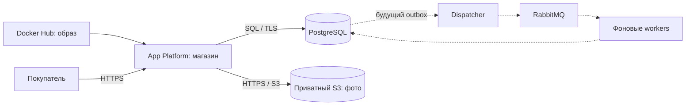

# Apex Store: Docker Hub → Timeweb Cloud

Инструкция подготовлена 25 октября 2026 года для текущего проекта.
Основной вариант: Docker Hub хранит образ, Timeweb App Platform запускает
приложение, PostgreSQL хранит данные, S3 — загруженные фотографии. Домен можно
подключить позже: для первого запуска подходит технический HTTPS-домен Timeweb.

Многострочные shell-примеры используют Bash (Linux/macOS/WSL).
В PowerShell объединяйте строки команды в одну, убирая завершающие `\`.



Пунктиром показаны будущие фоновые компоненты: сейчас они не подключены.

## 1. Что будет работать и что подготовлено

| Компонент | Где работает | Что требуется |
| --- | --- | --- |
| Витрина, админка, кабинет, API | Один контейнер приложения | Docker-образ, переменные окружения, порт 8000 |
| Каталог, заказы, аккаунты, интеграции | Внешний PostgreSQL | Доступ из приложения, реквизиты, TLS, перенос существующей БД |
| Фото, загруженные через админку | Внешнее S3-хранилище | Приватный бакет и ключи доступа |
| СДЭК и Т-Банк | Внешние API | Сохранённые настройки интеграций, правильный публичный адрес, при необходимости CA банка |
| RabbitMQ | Внешний брокер, после внедрения очередей | Сейчас не нужен; один URL ещё не включает обработку событий |
| `moto.apexgrid.ru`, `drive.apexgrid.ru` | DNS и привязки доменов | Покупка одного основного домена; отдельная настройка каждого поддомена |

В Dockerfile уже заданы `0.0.0.0:8000`, непривилегированный пользователь,
проверка `/ready` и корректное завершение процесса. `/health` проверяет HTTP,
`/ready` — также подключение к БД. При запуске автоматически применяются
миграции под блокировкой PostgreSQL.

Приложение поддерживает два способа хранения фото: `local` и `s3`.
В App Platform используйте `s3`: файловая система контейнера заменяется
при повторном деплое. Текущий `docker-compose.yml` запускает только локальную
базу для разработки; его не нужно выбирать для деплоя магазина.
В App Platform Compose также ограничены `volumes`.
[Как App Platform хранит данные](https://timeweb.cloud/docs/apps/how-it-works),
[ограничения Compose](https://timeweb.cloud/docs/apps/deploying-with-docker-compose).

## 2. Что создать в Timeweb

Создавайте ресурсы в одном подходящем регионе. Если используете приватную
сеть, выбирайте её для приложения сразу: App Platform не позволяет поменять
её у уже созданного приложения. Сам Docker Hub — реестр образов, а не место
работы БД или магазина.

### PostgreSQL

1. Создайте управляемый PostgreSQL. Для совместимости с текущими проверками
   подойдёт версия 16; уже работающий совместимый кластер можно сохранить.
2. Создайте отдельную БД и пользователя магазина. У пользователя должны быть
   права создавать таблицы/индексы и выполнять миграции в своей схеме.
3. Сохраните hostname, порт, имя базы, имя пользователя и пароль.
4. Для подключения по публичному hostname включите TLS и возьмите CA-сертификат
   из вкладки подключения. Рекомендуемая настройка приложения — `verify-full`:
   имя сервера должно соответствовать сертификату. Не подставляйте IP вместо
   указанного провайдером hostname.
5. Разрешите сетевой доступ от приложения. Если используется ограничение по IP,
   проверьте исходящий адрес приложения в Timeweb; он не обязательно равен адресу
   компьютера, с которого вы настраиваете магазин.

`POSTGRESQL_HOST=127.0.0.1` внутри контейнера означает сам контейнер приложения,
а не сервер вашей базы. Для внешней БД нужен её реальный hostname.
Если база доступна только через приватную сеть, приложение должно находиться
в совместимой сети; TLS/порт задавайте по параметрам именно этого подключения.
[Подключение к PostgreSQL в Timeweb](https://timeweb.cloud/docs/dbaas/postgresql/connect-to-database).

### S3 для фотографий

1. Создайте бакет в объектном хранилище Timeweb и оставьте его приватным.
2. Создайте ключи с правами чтения, записи объектов и просмотра бакета
   (`ListBucket` нужен, в частности, для проверки отсутствующего объекта).
3. Скопируйте имя бакета, Access Key, Secret Key, endpoint и регион.
4. В текущем примере используются `https://s3.twcstorage.ru` и `ru-1`;
   если панель показывает другие значения, используйте их.
5. Выберите постоянный префикс, например `apex/media`.

Браузер получает фото через `/media/...` приложения; ключи S3 ему не передаются.
Поэтому публичный бакет и CORS для прямой загрузки из браузера не требуются.
Файлы имеют имена по хешу и версии 240/480/960 px. Старые URL в БД менять не нужно.
Включите доступные у провайдера средства сохранения/резервирования объектов;
автоматическое удаление используемых фото по возрасту не настраивайте.
[Настройки S3 и boto3 в Timeweb](https://timeweb.cloud/docs/s3-storage/sdk/python).

## 3. Переменные приложения

Шаблон находится в [.env.production.example](.env.production.example).
Заполненный файл храните только у себя; в Git и Docker-образ он не включается.

```bash
cp .env.production.example .env.production
```

Заполните основные параметры:

| Переменная | Значение |
| --- | --- |
| `APP_ENV` | `production` |
| `APP_HOST`, `APP_PORT` | `0.0.0.0`, `8000` |
| `TRUST_PROXY_HEADERS` | `true` за доверенным прокси App Platform |
| `WEBAPP_URL` | Полный адрес вида `https://ваш-технический-домен`, без дополнительного пути |
| `ADMIN_USERNAME`, `ADMIN_PASSWORD` | Ваш логин и отдельный длинный пароль |
| `STORE_MASTER_KEY` | Действующий постоянный ключ магазина |
| `POSTGRESQL_*` | Реквизиты внешнего PostgreSQL |
| `POSTGRESQL_SSLMODE` | `verify-full` для соответствующего TLS-подключения |
| `POSTGRESQL_SSLROOTCERT_PEM` | Полный текст CA-сертификата БД |
| `STORE_MEDIA_BACKEND` | `s3` |
| `S3_ENDPOINT_URL`, `S3_REGION` | Значения из панели S3 |
| `S3_BUCKET`, `S3_PREFIX` | Бакет и постоянный префикс фотографий |
| `S3_ACCESS_KEY_ID`, `S3_SECRET_ACCESS_KEY` | Ключи доступа к бакету |

Для **уже существующего магазина** перенесите исходный `STORE_MASTER_KEY`
из действующего окружения. В БД им зашифрованы секреты СДЭК/банка. Генерация
другого ключа не расшифрует сохранённые интеграции. Ключ должен сохраняться
при всех обновлениях контейнера. Если он утерян, секреты интеграций придётся
вводить заново; копия одной БД ключ не заменяет.

Для **совершенно нового пустого магазина** можно один раз сгенерировать ключ:

```bash
python -c "import secrets; print(secrets.token_hex(32))"
```

Отдельно сгенерируйте пароль администратора, например:

```bash
python -c "import secrets; print(secrets.token_urlsafe(24))"
```

В production приложение отклоняет тестовый мастер-ключ, короткий пароль
администратора и неправильный публичный URL. Оно не выводит реквизиты в лог.

### Как передать CA-сертификаты без файлов в образе

В панели Timeweb значение `POSTGRESQL_SSLROOTCERT_PEM` — полный текст:

```text
-----BEGIN CERTIFICATE-----
содержимое сертификата провайдера
-----END CERTIFICATE-----
```

В локальном `.env.production` можно использовать двойные кавычки и `\n`
вместо переводов строк. Приложение создаст временный файл с правами `0600`.
Вместо PEM-переменной на обычном сервере допустим `POSTGRESQL_SSLROOTCERT`
с путём к смонтированному файлу. Два варианта одновременно задавать не нужно.

Если Т-Банку нужен дополнительный корневой сертификат, аналогично задайте
`TBANK_CA_CERT_PEM`. Возьмите сертификат из официального источника банка.
Для локального DER-файла `.cer` преобразование в PEM можно выполнить Python:

```python
import ssl
from pathlib import Path
source = Path("russian_trusted_root_ca.cer")
Path("tbank-root.pem").write_text(ssl.DER_cert_to_PEM_cert(source.read_bytes()))
```

Этот пример предназначен для бинарного DER; уже текстовый PEM преобразовывать
не нужно. Проверку TLS приложение не отключает.

`TRUST_PROXY_HEADERS=true` позволяет различать покупателей за прокси по
`X-Forwarded-For`. Используйте его только при доступе через доверенный прокси:
проверьте правила доступа к прямому сервисному порту 8000 в Timeweb. На обычном
сервере без прокси оставьте `false`. За HTTPS сессии получают флаг `Secure`.

## 4. Перенос уже работающего магазина

Если используете прежнюю внешнюю БД, переноса её данных не требуется:
задайте те же реквизиты и сохраните мастер-ключ. Для новой БД переносите
каталог, аккаунты, заказы, интеграции и историю целиком, а не только товары.

1. На время финального переноса остановите приём заказов и изменения данных.
2. Сохраните резервную копию исходной БД в custom-формате `pg_dump`.
3. Восстановите её в **пустую** целевую БД через `pg_restore`.
4. Перенесите файлы из существующего `var/media` в S3.
5. Запустите приложение, проверьте данные и после этого возвращайте трафик.

Пример дампа установленным PostgreSQL-клиентом. В файле `~/.pgpass` настройте
пароль по документации PostgreSQL и установите права `0600`, либо временно
используйте `PGPASSWORD` из вашего менеджера секретов. Пароль не вписывайте
в командную строку и не сохраняйте в историю команд.

Формат строки `.pgpass`: `host:port:database:user:password`; для источника и
назначения можно добавить отдельные строки. В Linux/macOS выполните
`chmod 600 ~/.pgpass`. В Windows файл называется
`%APPDATA%\postgresql\pgpass.conf`.
[Формат и экранирование паролей](https://www.postgresql.org/docs/16/libpq-pgpass.html).

```bash
mkdir -p backups
pg_dump --host=SOURCE_HOST --port=5432 --username=SOURCE_USER \
  --dbname=SOURCE_DATABASE --format=custom --no-owner --no-acl \
  --file=backups/apex.dump

pg_restore --host=TARGET_HOST --port=5432 --username=TARGET_USER \
  --dbname=TARGET_DATABASE --no-owner --no-acl --exit-on-error backups/apex.dump
```

Замените параметры прописными буквами на свои. Для TLS-клиента задайте
`PGSSLMODE=verify-full` и `PGSSLROOTCERT=/путь/к/CA.crt` по реквизитам
соответствующего сервера. Версия `pg_dump` должна быть не старше версии
исходного сервера. База резервной копии и целевая версия PostgreSQL должны
быть совместимы. Не используйте восстановление поверх действующего магазина.

С машины, где есть исходные фотографии и заполненный `.env.production`,
установите зависимости и выполните перенос:

```bash
python -m pip install -r requirements.txt
python -m store.manage --env-file .env.production upload-media --directory var/media
```

Команда загружает существующие WebP и их уменьшенные версии с теми же именами;
повторное выполнение допустимо. Записи каталога и адреса `/media/...` остаются
прежними. Пустой новый магазин можно начать без этого шага.

Если в старой базе остались изображения `data:image/...`, после восстановления
целевой БД выполните:

```bash
python -m store.manage --env-file .env.production migrate-media
```

При `STORE_MEDIA_BACKEND=s3` они сразу сохранятся в S3. До завершения переноса
не удаляйте исходную БД, файлы и резервные копии. Копии содержат данные
покупателей и реквизиты в зашифрованном виде; храните их вне публичного репозитория.

## 5. Образ в Docker Hub

Статья из запроса описывает сборку Dockerfile из Git. Для запуска уже собранного
образа используйте в Timeweb вкладку **Docker Hub** — это отдельный способ
деплоя. Согласно текущей документации, App Platform принимает оттуда публичные
образы. В образ входят код и зависимости; реквизиты и загруженные фото туда
не включаются.
[Деплой Dockerfile](https://timeweb.cloud/docs/apps/deploying-with-dockerfile),
[деплой Docker Hub](https://timeweb.cloud/docs/apps/deploying-with-docker-hub).

### Вариант A: вручную с компьютера

1. Создайте Docker Hub аккаунт и публичный репозиторий `apex-store`.
2. Создайте Personal Access Token с правами публикации и выполните `docker login`.
3. В каталоге проекта замените `YOUR_DOCKERHUB_USER` на свой логин:

```bash
docker login
docker buildx build --platform linux/amd64 \
  -t YOUR_DOCKERHUB_USER/apex-store:release-001 --push .
```

`linux/amd64` нужен и при сборке с Mac на Apple Silicon, чтобы получить
подходящую серверу архитектуру. Для каждого выпуска выбирайте новый тег.
Сохраните выведенный digest `sha256:...`: он фиксирует содержимое образа.
Не передавайте пароли, мастер-ключ или S3-реквизиты через `--build-arg`.

### Вариант B: через GitHub Actions

В репозитории уже есть [.github/workflows/docker-image.yml](.github/workflows/docker-image.yml).
Он запускается вручную и сам по себе не деплоит приложение в Timeweb.

1. В GitHub откройте **Settings → Secrets and variables → Actions**.
2. В **Variables** создайте `DOCKERHUB_USERNAME` со своим логином.
3. В **Secrets** создайте `DOCKERHUB_TOKEN` с токеном Docker Hub.
4. Откройте **Actions → Publish Docker image → Run workflow**, выберите `main`.
5. После успешного запуска получите образ `ВАШ_ЛОГИН/apex-store` с тегами полного
   SHA коммита и `latest`. В результате workflow также будет указан digest.

Для боевого приложения выбирайте digest или конкретную версию, чтобы случайное
обновление `latest` не меняло выбранный выпуск. Ключи PostgreSQL/S3/банка для
сборки не нужны и в GitHub Actions этого workflow не передаются.

## 6. Запуск в App Platform

1. Создайте приложение в **App Platform → Docker Hub**.
2. Укажите репозиторий `ВАШ_ЛОГИН/apex-store` и конкретный тег или digest.
3. Выберите регион и конфигурацию. Ресурсы приложения и PostgreSQL оплачиваются
   и масштабируются отдельно. Начните с небольшой конфигурации и проверяйте
   память при загрузке фотографий и задержки реальных запросов.
4. При необходимости сразу выберите приватную сеть, связанную с БД/будущим брокером.
5. Добавьте переменные из заполненного `.env.production` через настройки
   приложения. Если загружаете файл через панель, Timeweb требует имя `.env`:
   загрузите отдельную копию заполненного production-файла с таким именем,
   не перезаписывая рабочий `.env` проекта.
6. Порт контейнера — **8000**. Он также указан в `EXPOSE`. Внешние 80/443
   обслуживает прокси платформы; отдельный Nginx в образ добавлять не требуется.
7. Для проверки состояния укажите **`/ready`**, если поле доступно для выбранного
   способа деплоя. В образе уже есть собственный `HEALTHCHECK`.
8. Запустите деплой и дождитесь статуса успешного запуска.
9. Возьмите технический HTTPS-домен из дашборда и установите его в `WEBAPP_URL`.
   Если адрес появляется только после первого запуска, для первоначальной
   настройки допустим `https://example.invalid`; затем замените его и выполните
   повторный деплой **до проверки оплат**.

Обратите внимание на единицы в **Настройках веб-сервера**:

| Параметр прокси | Рекомендуемое начальное значение | Причина |
| --- | --- | --- |
| Максимальный размер тела | `25000` КБ | Лимит backend — 25 000 000 байт |
| Ожидание заголовков ответа | `90000` мс | Проверка СДЭК может выполнять несколько последовательных запросов |

Клиентские запросы также имеют собственные таймауты; увеличение лимита прокси
не отменяет их. Не включайте SPA fallback: маршруты `/api`, `/admin`, `/account`
обслуживает Python-приложение.
[Переменные](https://timeweb.cloud/docs/apps/variables),
[healthcheck](https://timeweb.cloud/docs/apps/healthcheck-path),
[параметры прокси](https://timeweb.cloud/docs/apps/reverse-proxy).

## 7. Проверка после первого запуска

```bash
curl -f https://YOUR_TECHNICAL_DOMAIN/health
curl -f https://YOUR_TECHNICAL_DOMAIN/ready
```

Ожидаются соответственно `{"status":"ok"}` и `{"status":"ready"}`.
Проверьте витрину, `/admin`, вход в кабинет и загрузку фотографии. Выполните
повторный деплой того же образа и убедитесь, что товар и фото сохранились.
Это одновременно проверяет внешнюю БД, S3 и правильность runtime-переменных.

После проверки адреса настройте интеграции в админке:

- СДЭК: выберите нужную среду, город и офис из справочника, проверьте подключение.
- Т-Банк: сначала тестовая среда; `WEBAPP_URL` должен указывать на этот магазин.
  Уведомления приходят на `https://YOUR_DOMAIN/api/payments/tbank/notification`.
  Страницы возврата: `/payment/success` и `/payment/fail`. Разрешите адреса по
  условиям своего терминала и проверьте подписанное подтверждение, сумму,
  появление заказа в кабинете и остатки.

`CDEK_*` из старого `.env` не заменяют интеграцию в БД. В рабочий Docker-образ
не нужно помещать логин СДЭК или пароль терминала. Если база и мастер-ключ
перенесены, существующие настройки интеграций сохранятся.

CAPTCHA сейчас имеет демонстрационный режим; установка `CAPTCHA_MODE=yandex`
сама по себе не добавит отсутствующий клиентский виджет. Реальный антибот-сценарий
и ограничения платёжной сверки описаны в README/DEVELOPMENT и не включаются
фактом деплоя. Подписи уведомлений и серверная проверка цен работают отдельно.

## 8. Домен и поддомены

`apexgrid.ru` здесь только пример — доступность имени нужно проверить перед
покупкой. После регистрации одного основного домена `moto.apexgrid.ru` и
`drive.apexgrid.ru` создаются DNS-записями; отдельные доменные имена для них
регистрировать не нужно.

В Timeweb:

1. Добавьте основной домен в **Домены и SSL** и настройте его DNS-обслуживание.
2. Создайте поддомены `moto` и `drive`.
3. В настройках нужного приложения откройте **Домены** и привяжите соответствующий
   поддомен. Для внешнего DNS добавьте A-запись, которую покажет Timeweb.
4. Дождитесь применения DNS и выпуска HTTPS-сертификата. App Platform выпускает
   и продлевает Let's Encrypt для привязанных доменов автоматически.
5. Измените `WEBAPP_URL`, повторите деплой и проверьте адреса оплаты/уведомлений.

Не угадывайте IP для DNS: берите его из панели конкретного приложения.
Привязка домена сама запускает повторный деплой, поэтому фото уже должны быть в S3.
[Привязка домена к App Platform](https://timeweb.cloud/docs/apps/upravlenie-apps-v-paneli),
[поддомены](https://timeweb.cloud/docs/domains/subdomains).

### Как разделить moto и drive

| Схема | Что увидит покупатель | Что потребуется |
| --- | --- | --- |
| Оба поддомена у одного приложения | Один и тот же магазин и каталог | Только DNS/привязки; одна каноническая `WEBAPP_URL` |
| Отдельное приложение для каждого направления | Независимые магазины | Один Docker-образ, разные БД, S3-префиксы, ключи и настройки |
| Разные витрины, общий аккаунт/баллы/корзина | Единая торговая система | Отдельная доработка маршрутизации, привязки данных к витрине и авторизации |

Сейчас приложение не выбирает отдельный каталог по hostname. DNS не добавляет
такую функцию. Для независимых магазинов можно использовать один собранный образ:

| Настройка | Moto | Drive |
| --- | --- | --- |
| Приложение Timeweb | `apex-moto` | `apex-drive` |
| `WEBAPP_URL` | `https://moto.apexgrid.ru` | `https://drive.apexgrid.ru` |
| `POSTGRESQL_DATABASE` | отдельная `apex_moto` | отдельная `apex_drive` |
| `S3_PREFIX` | `moto/media` | `drive/media` |
| `STORE_MASTER_KEY` | собственный постоянный ключ | собственный постоянный ключ |

Если ваш тариф БД не позволяет несколько баз, используйте отдельные кластеры.
Не указывайте одну и ту же БД, ожидая изоляцию: тогда товары, пользователи,
заказы и админские данные останутся общими. Каждый экземпляр использует пул
до 8 соединений PostgreSQL; учитывайте сумму по магазинам и будущим workers.
Общий вход между поддоменами сейчас не реализован, cookie и корзина привязаны
к конкретному хосту. Для новой разновидности повторите схему с новым приложением,
БД и префиксом. Сам образ можно использовать тот же.

## 9. Будущий RabbitMQ

Текущий магазин не подключается к RabbitMQ при запуске. Отдельный файл
`docker-compose.rmq.yml` и `requirements-rmq.txt` — заготовки для разработки.
Их наличие не означает, что письма, накладные и фоновые задания уже идут в очередь.

Для внедрения:

1. Поднимите отдельный брокер/управляемый RabbitMQ с постоянным хранением.
2. Создайте отдельного пользователя и vhost, настройте доступ из приватной сети
   или TLS. Не открывайте публично консоль управления и не используйте `guest`.
3. Добавьте transactional outbox в PostgreSQL и процесс dispatcher.
4. Реализуйте workers, идемпотентность и повторы/DLQ по [RABBITMQ.md](RABBITMQ.md).
5. Соберите отдельный образ/вариант образа с `requirements-rmq.txt` и запускайте
   dispatcher/workers отдельными процессами. Используйте среду, поддерживающую
   фоновые контейнеры; обычному App Platform web-приложению нужен HTTP healthcheck.
6. Передайте URL брокера как runtime-секрет этих процессов. Пароли с особыми
   символами в AMQP URL должны быть URL-кодированы.
7. Проверьте остановку брокера, повторную доставку и отсутствие повторных накладных.

Приложение, workers, БД и брокер могут находиться на разных сервисах Timeweb,
если между ними есть сетевой доступ. Данные БД и брокера не должны жить в
заменяемом web-контейнере. Простое добавление `RABBITMQ_URL` сейчас ничего
не активирует. До внедрения этих процессов сайт продолжает работать без RMQ.

## 10. Обновление, откат и резервные копии

Обычное обновление: изменения кода → коммит → сборка и публикация нового
Docker-образа → выбор его тега/digest в Timeweb → повторный деплой → `/ready`
и проверка витрины/фото. Для Docker Hub не рассчитывайте на Git-автодеплой:
обновление образа в реестре и запуск редеплоя приложения — разные действия.

При обновлении сохраняйте runtime-переменные, `STORE_MASTER_KEY`, БД, бакет
и `S3_PREFIX`. Контейнер можно заменить, внешние данные остаются на месте.
Простая смена префикса без копирования объектов приведёт к отсутствующим фото.

Перед релизом с миграциями сделайте резервную копию БД. Вернуть предыдущий
Docker digest можно через настройки приложения, но это не откатывает схему
и данные БД. Проверяйте совместимость старого кода с новой схемой; восстановление
резервной копии требует отдельного решения, чтобы не потерять новые заказы.

Храните отдельно: резервные копии PostgreSQL, копии/версии объектов S3,
постоянный мастер-ключ и перечень переменных окружения. Образ Docker Hub
резервной копией магазина не является.

## 11. Если что-то не работает

| Симптом | Что проверить |
| --- | --- |
| Контейнер сразу завершается | Логи; обязательные переменные, настоящий пароль/мастер-ключ, `WEBAPP_URL`, корректность PEM |
| `connection refused` к БД | Внешний hostname вместо localhost, порт, сеть и разрешение доступа |
| Ошибка TLS PostgreSQL | CA из панели, `verify-full`, hostname из сертификата, отсутствие двух взаимоисключающих CA-переменных |
| `/health` работает, `/ready` — 503 | Доступность PostgreSQL и свободные соединения пула |
| Фото исчезло после деплоя | Действительно выбран `s3`; перенесены старые файлы; не изменился префикс |
| Загрузка фото — 503 | Права S3, endpoint/регион, ключи, доступ к бакету |
| 413 при фотографии | Ограничение прокси Timeweb и лимит backend; уменьшите исходное фото |
| Ошибка СДЭК при настройке | Интеграция/среда/реквизиты, город и офис из списка, тариф склад–склад; см. CDEK.md |
| Т-Банк перенаправляет на старый адрес | `WEBAPP_URL`, повторный деплой, настройки терминала |
| Все пользователи попадают под один rate limit | Доверенный прокси, `TRUST_PROXY_HEADERS`, настоящий `X-Forwarded-For` |
| Два поддомена показывают одинаковые товары | Они направлены в один экземпляр/БД; DNS сам каталог не разделяет |

## Проверки этой подготовки

Прошли 138 тестов, включая PostgreSQL, S3-контракты, CA-сертификаты,
health/readiness, cookie и прокси. Образ собран и запущен с внешней PostgreSQL
и отдельным S3-совместимым тестовым сервером. Проверены UID 10001, загрузка
фото/миниатюр, сохранение товара и фото после замены контейнера, восстановление
готовности после сбоя БД и корректное завершение по SIGTERM.
Реальные ресурсы Timeweb, бакет и Docker Hub-аккаунт эта инструкция не создаёт;
реквизиты вашего аккаунта нужно заполнить при развёртывании. Проверки с реальным
договором СДЭК/терминалом банка выполняются после настройки выбранного домена.
