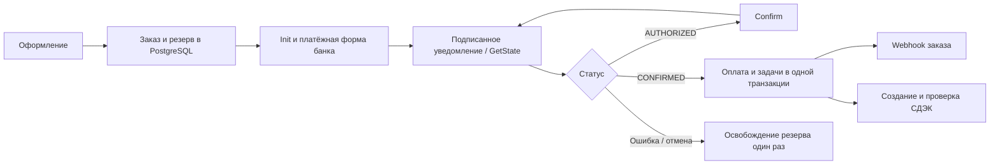

# Т-Банк, СДЭК и webhook: проверка интеграции и настройка

Проверка реализации: 26 октября 2026 года. Основной адрес магазина — `https://apextop.ru`.

## Что происходит с заказом

1. Сервер повторно проверяет цены, остатки, варианты, скидки и стоимость доставки. Создаёт заказ в PostgreSQL, резервирует товар и баллы. Повтор с тем же ключом не создаёт второй заказ.
2. В заказе сохраняются исходные настройки терминала. Пароль хранится зашифрованным `STORE_MASTER_KEY` и не возвращается в API. Переключение магазина с DEMO на рабочий терминал не меняет контекст уже созданных платежей.
3. `Init` получает сумму в копейках, состав чека, HTTPS-адреса возврата и уведомлений. Платёжная ссылка действует 30 минут. Покупатель вводит платёжные данные на странице банка.
4. Подписанное уведомление банка проверяется по терминалу, номеру заказа, идентификатору платежа и сумме. `AUTHORIZED` означает авторизацию средств, `CONFIRMED` — подтверждённую оплату. Для двухстадийной схемы списание подтверждает фоновая задача через `Confirm`.
5. Изменение оплаты и постановка последующих задач фиксируются одной транзакцией PostgreSQL. HTTP-обработчик отвечает банку `200 OK` с точным телом `OK`, без ожидания СДЭК и стороннего webhook.
6. После рабочего `CONFIRMED` отдельные задачи отправляют заказ в webhook и создают отправление СДЭК. Самовывоз не создаёт отправление. UUID/накладная и состояние доставки сохраняются в заказе.
7. Уведомления о фискализации сохраняются отдельно от оплаты. Касса, подключённая к терминалу, формирует и отправляет покупателю электронный чек. Сбой кассы не превращает оплаченный заказ в неоплаченный.



Страница `/payment/success` сама по себе **не подтверждает оплату**. Обе страницы возврата запрашивают состояние заказа и показывают результат, сохранённый сервером. `GetState` используется при задержке уведомления и по кнопке «Проверить оплату» в админке.

## Проверенные методы и границы сценария

| Метод / механизм | Как используется |
| --- | --- |
| [Init](https://developer.tbank.ru/eacq/api/init) | Создание сессии; сумма в копейках; чек; срок ссылки; `SuccessURL`, `FailURL`, `NotificationURL`; одностадийная или двухстадийная схема. |
| [GetState](https://developer.tbank.ru/eacq/api/get-state) | Проверка платежа сервером; сверка `PaymentId`, `OrderId`, суммы и терминала; восстановление результата после сетевого сбоя. |
| [CheckOrder](https://developer.tbank.ru/eacq/api/check-order) | Поиск платежа по заказу, когда ответ `Init` потерян. Повторный `Init` вслепую не отправляется. |
| [Confirm](https://developer.tbank.ru/eacq/api/confirm) | Подтверждение авторизованной оплаты с составом чека. Перед повтором проверяется фактическое состояние платежа. |
| [Cancel](https://developer.tbank.ru/eacq/scenarios/cancel_confirm/) | Закрытие неоплаченной сессии при удалении заказа. Сначала проверяется состояние. Передаётся нулевая сумма: для `NEW` банк игнорирует её и закрывает сессию; захваченный платёж автоматически не возвращается. Если банк требует ручного снятия авторизации, ошибка сохраняется в задаче. |
| [HTTP-уведомления](https://developer.tbank.ru/eacq/intro/developer/notification/) | SHA-256 по скалярным значениям; вложенные объекты и `null` исключаются. Повторные уведомления не начисляют баллы и не создают новые задачи повторно. |
| [Receipt и фискализация](https://developer.tbank.ru/eacq/scenarios/fiscalization) | Email покупателя, СНО, НДС товаров/доставки, отдельная строка доставки, ФФД 1.05/1.2. Сумма строк после скидок и баллов точно совпадает с оплатой. |
| [SendClosingReceipt](https://developer.tbank.ru/eacq/api/send-closing-receipt) | В текущем сценарии не вызывается: позиции имеют `PaymentMethod=full_payment`. Для схемы предоплаты с `full_prepayment`/`prepayment`/`advance` потребуется отдельная реализация закрывающего чека при передаче товара. |
| Платёжная форма банка | Карта, 3-D Secure и доступные терминалу способы оплаты обрабатываются банком. Методы самостоятельного ввода карты, привязки и рекуррентных списаний для этого сайта не нужны. |
| СДЭК | Выбор города/ПВЗ, расчёт доставки, создание после оплаты, проверка UUID/накладной и статусов, отмена отправления. При неизвестном результате POST повторное создание автоматически не выполняется: используется проверка существующего отправления. |

Частичный/полный возврат через интерфейс банка отражается уведомлением. Для частичного возврата автоматический пропорциональный пересчёт баллов, состава заказа и последующей отправки не реализован; такой заказ требует отдельного разбора администратором. **Кнопка удаления заказа не является кнопкой возврата денег.** После отправки/доставки товара возврат денег также не увеличивает складской остаток автоматически: фактический возврат вещи проверяется отдельно.

## Ошибка HTTP 403 и выбор среды

У банка есть два разных способа тестирования:

| Выбор в админке | TerminalKey | Адрес API | Реальные списания |
| --- | --- | --- | --- |
| DEMO — тестовый терминал | С `DEMO` | `https://securepay.tinkoff.ru/v2` | Нет |
| Тестовый API — нужен белый список IP | Рабочий, без `DEMO` | `https://rest-api-test.tinkoff.ru/v2` | Нет |
| Production | Рабочий, без `DEMO` | `https://securepay.tinkoff.ru/v2` | Да |

Терминал с `DEMO` автоматически направляется на правильный адрес даже при старой настройке «Тестовая». Режим DEMO с рабочим ключом отклоняется. После ошибки тестового API приложение не переключает рабочий терминал на боевой адрес автоматически.

Это различие описано в официальных [тест-кейсах DEMO](https://developer.tbank.ru/eacq/intro/errors/test-cases) и [инструкции тестовой среды](https://developer.tbank.ru/eacq/intro/errors/test).

Для `rest-api-test.tinkoff.ru` нужно разрешение банка на внешние IP. В чате Т-Бизнес передайте ИНН, название организации, публичный исходящий IP/пул Timeweb и адрес `rest-api-test.tinkoff.ru`. Для открытия тестовой формы также нужен разрешённый IP браузера. Уточнить исходящий IP App Platform можно у Timeweb: адрес Docker `172.18.0.3` из лога для этого не подходит.

Если 403 появляется на рабочем адресе, проверьте активацию магазина/терминала и ограничения доступа с поддержкой банка. В логе и карточке заказа сохраняются HTTP-код, адрес API и пояснение банка. По одному слову `Forbidden` нельзя доказать, какое именно ограничение сработало.

`GET /robots.txt 404` не являлся причиной отказа в оплате. Файл добавлен и возвращает 200.

## Как настроить тестовую оплату

1. Обновите образ сайта и дождитесь запуска. В «Интеграции → Т-Банк» задайте название, терминал DEMO и его пароль, среду DEMO. Либо используйте рабочий терминал с тестовым API после добавления IP в белый список.
2. Выберите схему оплаты, совпадающую с настройкой терминала: одностадийную или двухстадийную. Для двухстадийной приложение выполнит `Confirm` после авторизации.
3. Используйте тестовые карты именно из соответствующего раздела документации банка: [DEMO](https://developer.tbank.ru/eacq/intro/errors/test-cases) или [тестовый API](https://developer.tbank.ru/eacq/intro/errors/test).
4. В настройках терминала задайте HTTP-уведомления на `https://apextop.ru/api/payments/tbank/notification`. Платёжные адреса возврата приложение передаёт само.
5. Тестовые заказы помечаются в админке и личном кабинете. При успешном тесте резерв товара и потраченные баллы возвращаются, реальные бонусы не начисляются.
6. Для сквозного теста доставки используйте **тестовую интеграцию СДЭК**. Для DEMO-платежа боевое отправление запрещено; для рабочего платежа явно настроенная тестовая доставка также не используется.
7. Для сквозного теста webhook задайте в Timeweb `ORDER_TEST_WEBHOOK_URL` с адресом тестового обработчика. Без этой переменной тестовый заказ не отправляется рабочему webhook: в админке будет пояснение. Если сознательно используете тот же обработчик для тестов, можно указать его адрес; он получит такой же JSON, как для рабочего заказа.

## Переход к рабочим платежам и чеки

1. Замените DEMO-ключ и пароль реквизитами рабочего терминала и выберите **Production**. Сохранение старого ключа DEMO продолжит тестовый режим даже при выборе Production.
2. Для реальной доставки включите Production в СДЭК с рабочими реквизитами, городом и офисом отправления.
3. Подключите онлайн-кассу к терминалу в кабинете Т-Бизнес. Одна лишь передача JSON `Receipt` не подключает кассу.
4. В админке сайта включите передачу чека и задайте фактические СНО, НДС и ФФД подключённой кассы. Значения по умолчанию: УСН «доходы», без НДС, ФФД 1.05. Для 1.2 передаются `Receipt.FfdVersion=1.2` и единицы измерения.
5. Формат ФФД также должен совпадать с настройками кассы в Т-Бизнес. [Официальная инструкция подключения кассы](https://www.tbank.ru/business/help/business-payments/internet-acquiring/kassa/set-up/).
6. Уведомления о фискализации приходят на URL из **настроек терминала**, поэтому укажите там тот же адрес уведомлений, даже если `Init` уже передаёт `NotificationURL`. После выдачи чека сайт сохраняет подтверждение и доступную HTTPS-ссылку.
7. Убедитесь, что домен `apextop.ru` открывается по HTTPS и доступен банку. `WEBAPP_URL` должен быть `https://apextop.ru`.

Текущий формат позиции — `full_payment` (полный расчёт). Маркировочные коды товаров и сценарий закрывающих чеков предоплаты в этой реализации не добавлены. Не выбирайте схему предоплаты, рассчитывая на автоматический второй чек.

## Webhook заказа

Рабочий адрес по умолчанию:

```dotenv
ORDER_WEBHOOK_URL=https://2p2p.ru/tilda/apex/webhook
```

Тело соответствует предоставленной оболочке: `id`, `created_at`, `payload_type`, `customer_name`, `customer_email`, `contact`, `payload`, `cookies`, `client`, `headers`, `storage_status`, `queue_attempts`, `queue_error`. Поля `im_number` и `email_messages` отсутствуют.

В `payload` передаются `Name`, `Email`, `Phone`, `Name_2`, `formid`, `COOKIES`, `payment`, `formname`. В `payment` — `sys=tinkoff`, сумма, номер заказа и платежа, товары с SKU, цветом/размером и количеством, сумма товаров и данные доставки. Скидки и баллы учтены в стоимости товаров; округление распределяется по позициям так, чтобы сумма совпадала с оплатой. `formid=apex-checkout`, `formname=Cart`.

Браузерные cookies, токены входа и IP покупателя не копируются в служебную оболочку: `cookies={}`, `COOKIES=""`, `client.host=""`, `client.port=0`; `headers` описывает источник APEX и тип JSON. Данные покупателя находятся в полях заказа, а не в заголовках авторизации.

POST получает `Content-Type: application/json; charset=utf-8` и `Idempotency-Key: apex-paid-<UUID заказа>`. Полезная нагрузка сохраняется до первой отправки и повторяется неизменной. Любой 2xx считается подтверждением приёма; редиректы не выполняются. При 301/308 укажите конечный HTTPS-адрес в переменной.

Доставка выполняется с повторными попытками, максимум раз в шесть часов после длительной серии ошибок. При потере ответа после фактического приёма возможна повторная доставка. Обработчик должен устранять дубли по `id`/`Idempotency-Key`: одной стороны отправителя для гарантии «ровно один раз» недостаточно.

## Админка, удаление и восстановление после ошибок

- Фильтры применяются вместе на сервере ко всей таблице: поиск, оплата, сборка, получение, даты, диапазон суммы. Даты трактуются по Москве; конечная дата включается полностью.
- Сортировка: новые/старые, дорогие/недорогие. При равенстве используются дата и UUID. По умолчанию подгружаются 20 заказов; «Показать ещё» продолжает текущий запрос.
- После изменения этапа сборки список перечитывается с текущими фильтрами. Запоздавший ответ предыдущего поиска не подменяет результат.
- «Удалить заказ» скрывает заказ в списках магазина и кабинете покупателя. Бухгалтерская история, платёжные связи и аудит сохраняются. Неоплаченная сессия закрывается отдельной задачей; возврат оплаченного заказа не выполняется.
- Если уже удалённый неоплаченный заказ всё же подтверждён банком, он снова появляется для исполнения. Подтверждённые деньги не теряются из-за гонки с удалением.
- «Проверить оплату» сверяет заказ с банком. Ошибки кассы, СДЭК и webhook видны отдельно от статуса оплаты. «Повторить передачу» запускает повтор после исправления настроек.
- После неопределённого ответа `Init` используется `CheckOrder`, а не повторный POST. Неиспользованная найденная сессия без восстановимой платёжной ссылки закрывается. Явно отклонённые при создании заказы без банковской сессии освобождают резерв после 30 минут либо сразу при удалении.

Очередь хранится в PostgreSQL (`order_jobs`) и запускается двумя фоновыми потоками процесса сайта. Задачи переживают перезапуск Docker, имеют аренду обработки и безопасно выбираются несколькими экземплярами приложения. RabbitMQ для этого обновления не нужен. Исторические оплаченные заказы не отправляются повторно при миграции.

При обновлении образа миграция `007_payment_jobs.sql` выполнится автоматически. Не пересоздавайте БД и не меняйте `STORE_MASTER_KEY`: он нужен для ранее зашифрованных реквизитов.

## Что проверено и что остаётся проверить на сервере

Автоматические проверки покрывают подписи и `null`, разные тестовые хосты, ошибки/таймауты, суммы чеков, повторные и ранние уведомления, двухстадийное подтверждение, восстановление после потери `Init`, удаление и возвраты, переключение терминалов, изоляцию DEMO, очередь и её повторный запуск, JSON webhook, СДЭК, совместные фильтры и пагинацию. Интерфейс проверен в Chromium на компьютере и мобильном экране.

Живой платёж, реальный чек, отправление и POST на ваш рабочий 2p2p из этой сессии **не выполнялись**: production-реквизиты находятся только в Timeweb. Проверки используют отдельные схемы БД и тестовые ответы внешних сервисов. Прямое чтение части страниц developer.tbank.ru завершалось таймаутом; сверка выполнена по доступным официальным индексируемым описаниям методов, уведомлений, тестовых сред и кассы. Полную OpenAPI-спецификацию загрузить не удалось.

После деплоя проведите один DEMO-заказ и проверьте его статус, затем кассу и тестовые получатели. Для рабочего запуска проверьте реальную оплату выбранным рабочим терминалом, получение email-чека кассой, наличие заказа в 2p2p и UUID/накладной в СДЭК. Ошибку доступа 403 на стороне банка при необходимости снимает поддержка банка — изменение Python-кода не добавляет IP в их белый список.
